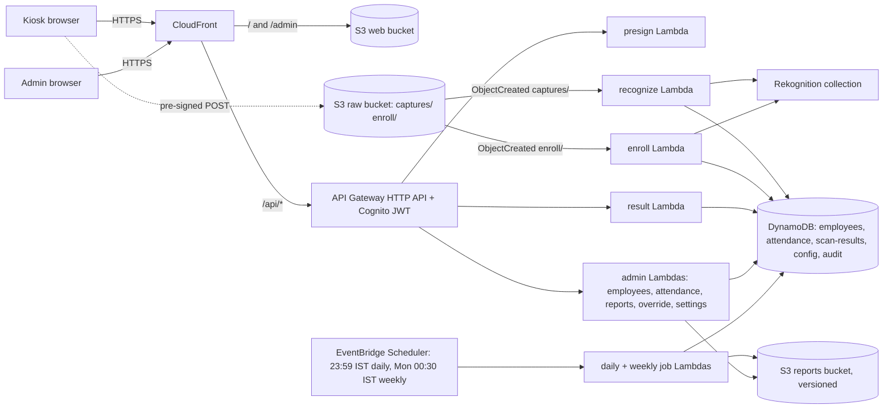

# Serverless Face-Recognition Attendance System

Contactless, real-time employee clock-in / clock-out using face recognition on AWS. A kiosk browser captures a still image, uploads it to S3, and a Lambda matches the face against an Amazon Rekognition collection before writing attendance to DynamoDB. Scheduled jobs mark absences and publish daily and weekly summaries. The Cognito-authenticated admin app manages employees, attendance, settings and reports.

**Production:** [Kiosk](https://d2l1fs6zsfo1ga.cloudfront.net/kiosk/) · [Admin](https://d2l1fs6zsfo1ga.cloudfront.net/admin/) · Region: `us-east-1` · AWS account: `924422830139`.

**Release status:** Production is deployed and core acceptance (employee enrollment, kiosk recognition, daily/weekly reports, 20-scan and browser acceptance) has been operator-confirmed. Numeric p95 output and several operational/security evidence gates remain tracked in [docs/STATUS.md](docs/STATUS.md); do not treat operator confirmation as a substitute for attached test artifacts.

**Project docs:** [Production status](docs/STATUS.md) · [Frozen specification](docs/SPEC.md) · [Architecture](docs/ARCHITECTURE.md) · [Deployment runbook](docs/DEPLOYMENT-RUNBOOK.md) · [Operations runbook](docs/OPERATIONS-RUNBOOK.md) · [Cost sheet](docs/COST.md) · [Demo storyboard](docs/DEMO_SCRIPT.md) · [Team brief](docs/TEAM_BRIEF.md)

## Architecture



## Tech stack
AWS (us-east-1): S3, CloudFront, API Gateway (HTTP API), Cognito, Lambda (Python 3.12), Rekognition, DynamoDB, EventBridge Scheduler, KMS, SNS, CloudWatch. Infrastructure as code: Terraform. CI/CD: GitHub Actions (OIDC to AWS, no stored keys). Frontend: static HTML + vanilla JS (no build step).

**Region invariant:** `config/deployment.json` is the single canonical region manifest. Terraform providers, the local Terraform wrapper and the GitHub deployment workflow read/export that value. Lambda SDK clients use the Lambda-reserved `AWS_REGION`. CI rejects conflicting regional ARNs, AWS endpoints, legacy region references or duplicate backend-region settings.

## Repository layout
```
docs/        SPEC (finish line), contracts, architecture, team brief, per-part guides, status
config/     canonical deployment region manifest
infra/       bootstrap (state + OIDC), foundation, modules/{data,recognition,access}, envs/{dev,prod,billing}
shared/      attendance_common Python layer (config, time, auth, responses, record_scan)
services/    Lambda source: recognition/ (Part A), data/ (Part B)
web/         kiosk/, admin/, shared/ (Part C)
tests/       unit/, contract/, integration/
scripts/     region guard, Terraform wrapper, read-only AWS preflight, e2e smoke test
```

## Environments and branches
`main` is the production source-of-truth branch. `develop` is reserved for development integration; feature branches should be short-lived and merged by pull request. The production environment is currently deployed from the release-candidate code now merged into `main`. The GitHub Actions Terraform workflow remains manual: generate a plan, review it, then explicitly select apply. The live production deployment in this release was performed through the reviewed local Terraform workflow, not by claiming the GitHub Actions deploy workflow ran. Never apply Terraform from a commit whose plan has not been reviewed.

## Frontend and local verification
The kiosk is served at `/`, the admin app at `/admin/`, and Cognito returns to `/callback.html`. See [docs/FRONTEND.md](docs/FRONTEND.md) for local run instructions, runtime configuration and the browser verification matrix. The generated `web/config.json` is ignored by Git and uploaded by the access Terraform module.

## Deploy
See [docs/DEPLOYMENT-RUNBOOK.md](docs/DEPLOYMENT-RUNBOOK.md), [docs/ARCHITECTURE.md](docs/ARCHITECTURE.md) section 11 and [infra/bootstrap/README.md](infra/bootstrap/README.md). CI validates changes. The GitHub OIDC deployment workflow is available but has not been used for the current production deployment; the live stack was deployed through the local Terraform workflow. Follow the runbook and inspect a saved plan before any future apply.

## Documents
| Doc | Purpose |
|---|---|
| [SPEC](docs/SPEC.md) | What "done" means. Frozen. |
| [contracts](docs/contracts.md) | Every name, schema, endpoint, code. Frozen. |
| [ARCHITECTURE](docs/ARCHITECTURE.md) | Technical design document |
| [TEAM_BRIEF](docs/TEAM_BRIEF.md) | Read this first if you are on the team |
| [parts/](docs/parts) | Build guides for Part A, B, C |
| [COST](docs/COST.md) | Cost sheet (100 employees, 2 scans/day) |
| [DEMO_SCRIPT](docs/DEMO_SCRIPT.md) | Video storyboard |
| [AI_CONTEXT](docs/AI_CONTEXT.md) | Paste into any AI assistant at the start of a session |
| [FRONTEND](docs/FRONTEND.md) | Local run, Cognito config and browser verification |
| [SCRIPTS](scripts/README.md) | Consent-gated deployed dev smoke test |
