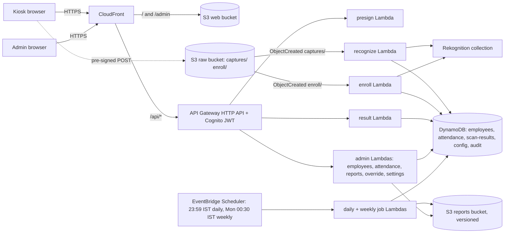

# Serverless Face-Recognition Attendance System

Contactless, real-time employee clock-in / clock-out using face recognition on AWS. A kiosk browser captures a still image, uploads it straight to S3, and a Lambda matches the face against an Amazon Rekognition collection, writes a timestamped attendance record to DynamoDB, and shows the result in under 3 seconds. Scheduled jobs mark absences and publish daily and weekly summaries. An admin web app lets HR filter and export attendance.

**Status:** [docs/STATUS.md](docs/STATUS.md) | **Finish line:** [docs/SPEC.md](docs/SPEC.md) | **New to the team?** Start with [docs/TEAM_BRIEF.md](docs/TEAM_BRIEF.md)

## Architecture



## Tech stack
AWS (ap-south-1): S3, CloudFront, API Gateway (HTTP API), Cognito, Lambda (Python 3.12), Rekognition, DynamoDB, EventBridge Scheduler, KMS, SNS, CloudWatch. Infrastructure as code: Terraform. CI/CD: GitHub Actions (OIDC to AWS, no stored keys). Frontend: static HTML + vanilla JS (no build step).

## Repository layout
```
docs/        SPEC (finish line), contracts, architecture, team brief, per-part guides, status
infra/       bootstrap (state + OIDC), foundation, modules/{data,recognition,access}, envs/{dev,prod}
shared/      attendance_common Python layer (config, time, auth, responses, record_scan)
services/    Lambda source: recognition/ (Part A), data/ (Part B)
web/         kiosk/, admin/, shared/ (Part C)
tests/       unit/, contract/, integration/
scripts/     seed data, e2e smoke test
```

## Environments and branches
`develop` auto-deploys to **dev**; `main` deploys to **prod** after manual approval. Feature branches: `a/<topic>`, `b/<topic>`, `c/<topic>`, `lead/<topic>`; open PRs into `develop`.

## Deploy
See [docs/ARCHITECTURE.md](docs/ARCHITECTURE.md) section 11 (bootstrap once, then CI deploys).

## Documents
| Doc | Purpose |
|---|---|
| [SPEC](docs/SPEC.md) | What "done" means. Frozen. |
| [contracts](docs/contracts.md) | Every name, schema, endpoint, code. Frozen. |
| [ARCHITECTURE](docs/ARCHITECTURE.md) | Technical design document |
| [TEAM_BRIEF](docs/TEAM_BRIEF.md) | Read this first if you are on the team |
| [parts/](docs/parts) | Build guides for Part A, B, C |
| [COST](docs/COST.md) | Cost sheet (100 employees, 2 scans/day) |
| [DEMO_SCRIPT](docs/DEMO_SCRIPT.md) | Video storyboard |
| [AI_CONTEXT](docs/AI_CONTEXT.md) | Paste into any AI assistant at the start of a session |
