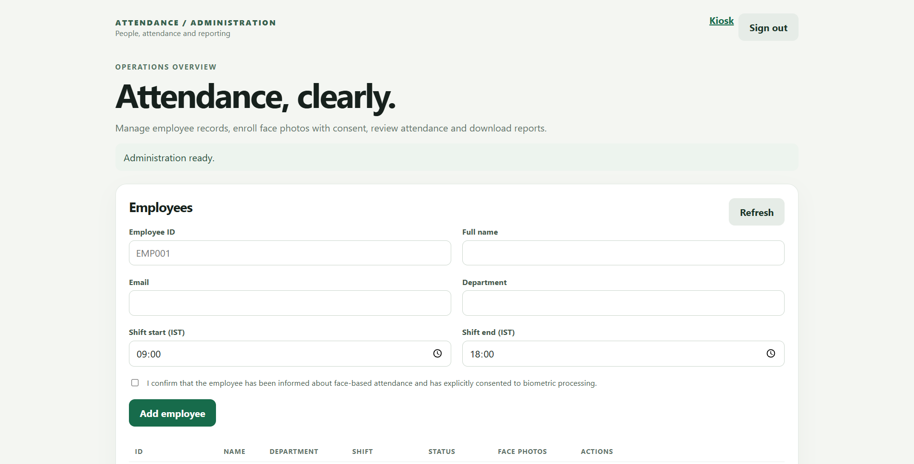
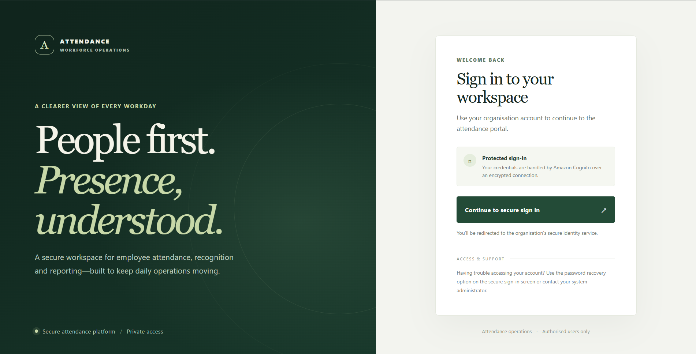
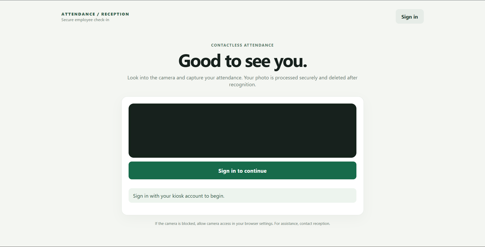
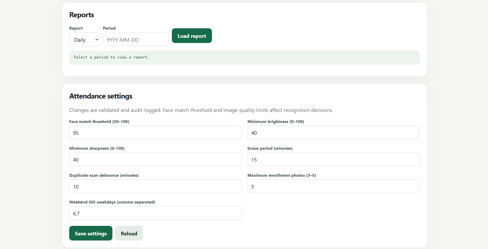
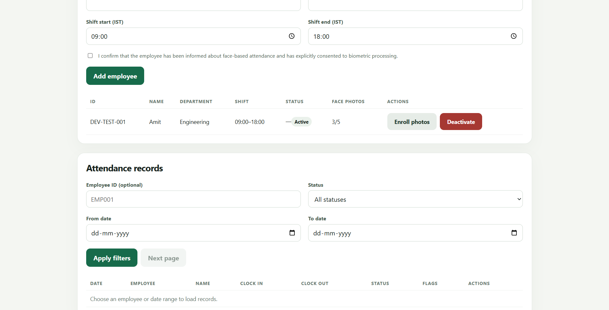
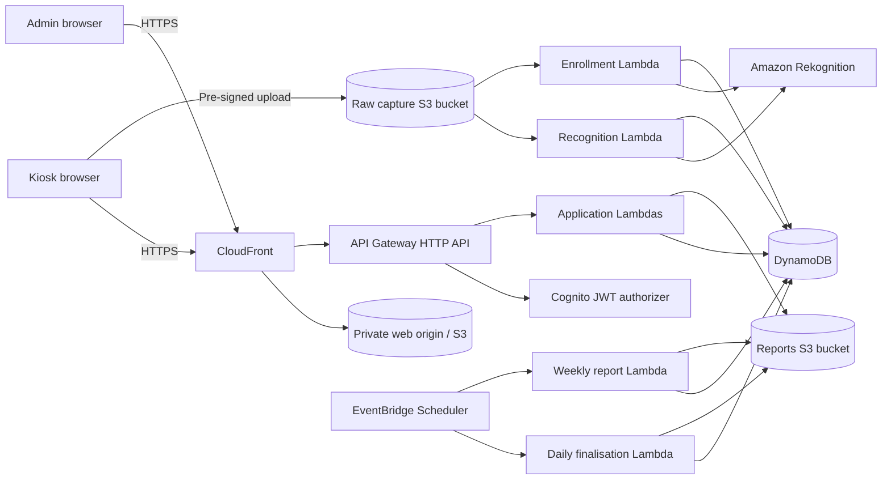

# Face-Recognition Attendance System

<p align="center">
  <strong>AWS serverless attendance platform with face recognition, employee administration and workforce reporting.</strong>
</p>

<p align="center">
  
</p>

<p align="center">
  <em>System architecture · AWS us-east-1 · Employee kiosk · Admin workspace · Reporting pipeline</em>
</p>


A serverless employee-attendance platform built on AWS. Employees use a browser-based kiosk to record attendance through face recognition; authorised administrators manage employee records, review attendance, configure recognition policy and generate daily and weekly reports.

The repository contains the application, infrastructure-as-code, automated tests, operational runbooks and release evidence. It is designed around a static-first browser frontend and event-driven AWS services.

## F13 Technologies Internship Context

**Internship:** AWS Cloud Intern (Cloud Engineering) · F13 Technologies · September 2026 – Present  
**Project sequence:** Project 2 of 3  
**Collaboration:** Developed collaboratively with the F13 Technologies intern team.

This was the second major project undertaken during my F13 Technologies internship. I contributed as part of the team building an AWS-hosted, serverless attendance platform, combining cloud infrastructure, application services, identity and access controls, biometric recognition, scheduled reporting and operational safeguards.

The repository documents the shared system architecture, implementation, tests, deployment and acceptance evidence. It should be understood as a team-delivered internship project; individual ownership should be attributed only where supported by the repository's commit history, pull requests and work records.

> **Release transparency:** The production environment is deployed. Core workflows have been operator-confirmed, including employee enrollment, kiosk recognition and daily/weekly report generation. Some operational and security acceptance evidence remains open; see [Production status](docs/STATUS.md). A deployed system should not be described as fully release-complete until every required evidence gate is closed.

## Live application

| Experience | URL | Purpose |
|---|---|---|
| Employee kiosk | [Open kiosk](https://d2l1fs6zsfo1ga.cloudfront.net/kiosk/) | Employee attendance capture |
| Admin sign-in | [Open sign-in](https://d2l1fs6zsfo1ga.cloudfront.net/signin/?returnTo=%2Fadmin%2F) | Administrator authentication |
| Admin dashboard | [Open dashboard](https://d2l1fs6zsfo1ga.cloudfront.net/admin/) | Employee, attendance, settings and reporting operations |

The application is deployed behind CloudFront in AWS region `us-east-1`. Runtime configuration is environment-specific and must not be committed as a secret or copied from production into development.

## Product capabilities

### Employee-facing kiosk
- Browser camera capture for contactless attendance.
- Pre-signed S3 upload flow; raw captures are processed asynchronously.
- Face matching through Amazon Rekognition.
- Attendance decisions are recorded against the employee and business date.
- Recognition and quality controls are designed to reject invalid or ambiguous scans rather than silently create attendance.

### Administrator workspace
- Create and manage employee records.
- Record explicit biometric-processing consent before enrollment.
- Enroll and manage employee face photos.
- Deactivate employees and remove biometric templates while retaining attendance history.
- Search and paginate attendance records.
- Review attendance flags and make reason-backed, audited corrections.
- Configure face-match and image-quality thresholds, grace period, duplicate-scan debounce, enrollment photo limits and weekend policy.

### Reporting
- **Daily report:** active workforce count, present, late, absent and missing-clock-out totals, plus employee-level attendance details.
- **Weekly report:** working-day-aware present, late and absence percentages, plus employee-level totals and rates.
- Download generated CSV exports through short-lived pre-signed links.
- Daily finalisation runs at 23:59 Asia/Kolkata; weekly aggregation runs Monday at 00:30 Asia/Kolkata.

Reports are generated by scheduled jobs and stored in the reports bucket. The admin reports endpoint reads the generated JSON summary and prepares a time-limited CSV download link. If a report has not yet been generated for the selected period, the API returns a not-found response; the UI should communicate that clearly rather than fabricate zero-valued results.

## Application screenshots

The following screenshots document the current user interfaces. They are reference material, not assets loaded by the production frontend.

### Admin dashboard


### Admin sign-in


### Employee attendance kiosk


### Reports and attendance settings


### Attendance records and filters


See [docs/screenshots/README.md](docs/screenshots/README.md) for the screenshot inventory and filenames.

## Architecture



### AWS services

| Layer | Services | Responsibility |
|---|---|---|
| Edge and frontend | CloudFront, S3 | Static kiosk/admin delivery |
| Identity | Amazon Cognito | Administrator and kiosk identity; JWT authorisation |
| API | API Gateway HTTP API, Lambda | Validated application operations |
| Recognition | S3, Lambda, Amazon Rekognition | Temporary capture processing and face matching |
| Data | DynamoDB | Employees, attendance, configuration, scan results and audit records |
| Reporting | Lambda, S3 | Daily/weekly aggregation, JSON summaries and CSV exports |
| Scheduling | EventBridge Scheduler | IST-aligned daily and weekly jobs |
| Security and operations | KMS, IAM, CloudWatch, SNS | Encryption, least-privilege execution, logs and alerts |

## Technology

- **Frontend:** semantic HTML, CSS and vanilla JavaScript; static delivery, no frontend build step.
- **Backend:** Python 3.12 AWS Lambda functions.
- **Cloud:** AWS S3, CloudFront, API Gateway, Cognito, Rekognition, DynamoDB, EventBridge Scheduler, KMS, CloudWatch and SNS.
- **Infrastructure:** Terraform.
- **Testing:** pytest, Moto-based AWS service tests, contract checks and static validation.
- **CI:** GitHub Actions.

### Region invariant

`config/deployment.json` is the canonical AWS region manifest. Terraform roots, deployment wrappers and CI checks must use that value. Lambda code uses the Lambda-reserved `AWS_REGION`. Do not add a second hard-coded region source.

## Repository structure

```text
.
├── config/                 # Canonical deployment configuration
├── docs/
│   ├── screenshots/        # UI reference screenshots
│   ├── parts/              # Work-package implementation guides
│   ├── SPEC.md             # Frozen functional and acceptance specification
│   ├── STATUS.md           # Current project and release evidence
│   ├── ARCHITECTURE.md     # System design
│   ├── contracts.md        # API/data contracts
│   ├── DEPLOYMENT-RUNBOOK.md
│   ├── OPERATIONS-RUNBOOK.md
│   ├── FRONTEND.md
│   └── COST.md
├── infra/                  # Terraform modules, environments and bootstrap
├── services/               # Lambda handlers
├── shared/                 # Shared Python Lambda layer
├── web/                    # Kiosk, admin and shared browser code
├── tests/                  # Unit, contract and integration tests
└── scripts/                # Validation, preflight and operational scripts
```

## Development and verification

Read the documents in this order before changing the system:

1. [Specification](docs/SPEC.md) — product scope and acceptance criteria.
2. [Architecture](docs/ARCHITECTURE.md) — service boundaries and data flow.
3. [Contracts](docs/contracts.md) — API and data contracts.
4. [Frontend guide](docs/FRONTEND.md) — static app, runtime configuration and browser checks.
5. [Deployment runbook](docs/DEPLOYMENT-RUNBOOK.md) — controlled infrastructure workflow.
6. [Operations runbook](docs/OPERATIONS-RUNBOOK.md) — alarms, recovery, offboarding and operations.
7. [Current status](docs/STATUS.md) — what is verified, what remains open and evidence references.

Use a feature branch and pull request for changes. Preserve existing contracts unless a deliberate versioned change is approved. Run the repository's CI checks and inspect the exact commit before merging.

## Deployment safety

Infrastructure changes are not ordinary application releases. Never run Terraform apply against dev or production without:
- verifying the AWS account and region;
- reviewing the exact saved plan;
- checking IAM scope and resource impact;
- obtaining the required explicit approval;
- recording the resulting deployment and acceptance evidence.

The GitHub Actions infrastructure workflow is manual and approval-gated. Follow [the deployment runbook](docs/DEPLOYMENT-RUNBOOK.md); do not infer that a workflow has deployed infrastructure merely because CI passed.

## Security and privacy principles

- Keep raw face captures separate from long-lived employee and attendance records.
- Use pre-signed uploads and narrowly scoped IAM permissions.
- Require explicit employee consent before biometric enrollment.
- Restrict administrative APIs to the admin authorization group.
- Keep audit records for administrative changes.
- Encrypt data in transit and at rest using the configured AWS controls.
- Do not log passwords, tokens, raw face images or biometric templates.
- Follow the documented retention, deletion and incident-response procedures.

These are system design and implementation requirements; live enforcement evidence is tracked separately in [docs/STATUS.md](docs/STATUS.md).

## Project documentation

| Document | What it covers |
|---|---|
| [SPEC.md](docs/SPEC.md) | Frozen product requirements and definition of done |
| [STATUS.md](docs/STATUS.md) | Current implementation, release gates and evidence |
| [ARCHITECTURE.md](docs/ARCHITECTURE.md) | Architecture and technical design |
| [contracts.md](docs/contracts.md) | API, event and data contracts |
| [DEPLOYMENT-RUNBOOK.md](docs/DEPLOYMENT-RUNBOOK.md) | Bootstrap, plan, approval and deployment |
| [OPERATIONS-RUNBOOK.md](docs/OPERATIONS-RUNBOOK.md) | Monitoring, alerts, recovery and operations |
| [FRONTEND.md](docs/FRONTEND.md) | Frontend setup and browser verification |
| [COST.md](docs/COST.md) | Cost model and assumptions |
| [DEMO_SCRIPT.md](docs/DEMO_SCRIPT.md) | Demonstration storyboard |
| [TEAM_BRIEF.md](docs/TEAM_BRIEF.md) | Team onboarding and work-package context |
| [AI_CONTEXT.md](docs/AI_CONTEXT.md) | Project context for AI-assisted work |
| [scripts/README.md](scripts/README.md) | Validation and smoke-test scripts |

## License

This repository is distributed under the [MIT License](LICENSE).
