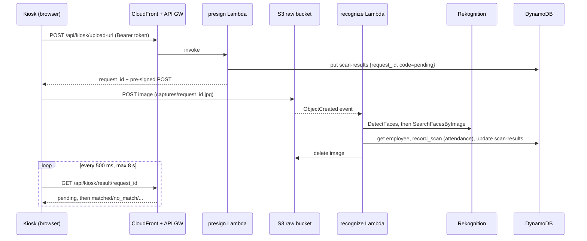

# Technical Design Document

Serverless Face-Recognition Attendance System. Version 1.0 (11 Nov 2026). Companion docs: [SPEC](SPEC.md), [contracts](contracts.md), [COST](COST.md).

## 1. Context and goals
Replace swipe cards and paper registers with contactless face-based clock-in/out for about 100 employees. Goals: result on screen within 3 s; no biometric images retained; least-privilege security; low, predictable cost; fully reproducible infrastructure; operable by a small team.
Non-goals (v1): liveness detection, multi-site, payroll integration.

## 2. Architecture diagram
See the diagram in [README.md](../README.md). Export it as PNG (mermaid.live) for the PDF version of this document.

## 3. Scan sequence

Latency budget (target p95 under 3 s): client resize + upload about 0.5 s, S3 event about 0.3 s, Lambda warm about 0.1 s, Rekognition two calls about 0.8 s, DynamoDB about 0.1 s, poll interval up to 0.5 s.

## 4. Components
| Component | Tech | Part |
|---|---|---|
| Kiosk and admin web apps | static HTML/JS on S3 behind CloudFront (OAC) | C |
| Auth | Cognito user pool, Hosted UI + PKCE, groups `admin`, `kiosk` | C |
| API | API Gateway HTTP API, JWT authorizer, routes built from module outputs | C |
| Recognition | presign, result, recognize, enroll, enroll-url, faces-delete Lambdas; Rekognition collection | A |
| Data and automation | 5 DynamoDB tables, employees/attendance-query/reports/override/settings Lambdas, daily-job, weekly-job, EventBridge Scheduler | B |
| Platform | KMS, buckets, layer, SNS, alarms, budgets, CI/CD, bootstrap | Lead |

## 5. Data model
Defined in [contracts.md](contracts.md) section 3. Access patterns: by employee over a date range (PK query), by date for all employees (GSI `date-index`), employee list (about 100 items; Scan is acceptable and cached in the admin Lambda), result polling by `request_id` (TTL 1 day).

## 6. Security
### 6.1 IAM matrix (one role per Lambda; all also get CloudWatch Logs on their own log group and `kms:Decrypt`/`kms:GenerateDataKey` on the attendance KMS key)
| Lambda | Allowed actions and resources |
|---|---|
| presign | `s3:PutObject` on raw `captures/*`; `dynamodb:PutItem` on scan-results |
| result | `dynamodb:GetItem` on scan-results |
| recognize | `rekognition:DetectFaces`; `rekognition:SearchFacesByImage` on the collection; `s3:GetObject`, `s3:DeleteObject` on raw `captures/*`; `dynamodb:GetItem` employees + config; `GetItem`/`PutItem`/`UpdateItem` attendance; `GetItem`/`UpdateItem` scan-results; `sqs:SendMessage` on its DLQ |
| enroll | `rekognition:DetectFaces`; `IndexFaces`, `SearchFacesByImage` on the collection; `s3:GetObject`, `s3:DeleteObject` on raw `enroll/*`; `dynamodb:GetItem`/`UpdateItem` employees; `GetItem` config; `GetItem`/`UpdateItem` scan-results; DLQ send |
| enroll-url | `s3:PutObject` on raw `enroll/*`; `dynamodb:GetItem` employees; `PutItem` scan-results |
| faces-delete | `rekognition:DeleteFaces` on the collection; `dynamodb:GetItem`/`UpdateItem` employees; `PutItem` audit |
| employees | `dynamodb:GetItem`/`PutItem`/`UpdateItem`/`Scan` employees; `PutItem` audit |
| attendance-query | `dynamodb:Query` attendance and `attendance/index/date-index`; `Scan` employees |
| reports | `s3:GetObject` on reports `reports/*` |
| override | `dynamodb:GetItem` employees; `GetItem`/`UpdateItem`/`PutItem` attendance; `PutItem` audit |
| settings | `dynamodb:GetItem`/`PutItem`/`UpdateItem` config; `PutItem` audit |
| daily-job | `dynamodb:Scan` employees; `Query` attendance and `attendance/index/date-index`; `PutItem`/`UpdateItem` attendance; `GetItem` config; `s3:PutObject` reports `reports/daily/*`; `sns:Publish` alerts topic |
| weekly-job | `dynamodb:Scan` employees; `Query` attendance (+ index); `GetItem` config; `s3:PutObject` reports `reports/weekly/*`; `sns:Publish` alerts topic |
`rekognition:DetectFaces` does not support resource-level permissions, so `*` is acceptable only for that one action. `daily-job` needs `dynamodb:UpdateItem` on attendance to add the `missing_clock_out` flag after checking a clock-in without a clock-out.

### 6.2 Controls
- Encryption at rest: DynamoDB (KMS), S3 (SSE-KMS with bucket key), CloudWatch logs unencrypted of PII by design (no PII logged). TLS enforced by bucket policies (`aws:SecureTransport`) and CloudFront (redirect to HTTPS, TLS 1.2+).
- Raw bucket: Block Public Access, no versioning, Lambda deletes the image right after processing, lifecycle expires `captures/` and `enroll/` after 1 day (S3 minimum granularity) plus noncurrent versions and incomplete multipart uploads. Reports bucket: versioning on (audit trail). Web bucket: private, CloudFront OAC only.
- Pre-signed POST: 60 s expiry, JPEG only, 1 KB to 1 MB, key fixed by server.
- API: Cognito JWT authorizer on every route + group check in the Lambda; API Gateway throttling (10 req/s, burst 20 per stage); Lambda reserved concurrency caps on `recognize` and `enroll` to bound Rekognition spend.
- Response headers on CloudFront: HSTS, CSP (self + S3 regional endpoint + Cognito domain), `X-Content-Type-Options`, `Permissions-Policy: camera=(self)`.
- Secrets: none in code. CI uses GitHub OIDC; no long-lived AWS keys.

### 6.3 Threat model (summary)
| Threat | Mitigation | Residual risk |
|---|---|---|
| Photo/video of an employee shown to the camera | Strict threshold, supervised kiosk, audit trail | Real in v1; fix is Face Liveness (LATER) |
| Someone abuses upload endpoint | Auth required, pre-signed POST limits, throttling, concurrency cap, budget alarm | Low |
| Stolen kiosk token | Dedicated `kiosk` user with kiosk-only routes, 60 min access tokens, disable the user to revoke | Medium (device theft) |
| Biometric data leak | Images deleted immediately; only Rekognition feature vectors kept; KMS, least privilege | Low |
| Admin misuse | Cognito admin group, override requires reason and is audited | Low |
| Cost attack | Throttling, reserved concurrency, AWS Budget alarm | Low |
### 6.4 Privacy and compliance
Biometric data is personal data (India DPDP Act 2023 applies). Controls: explicit consent captured at enrollment (`consent_at`), purpose limitation (attendance only), no retention of raw images, deletion of faces on offboarding, access limited to admins. Have HR/mentor confirm the consent text. This is engineering guidance, not legal advice.

## 7. Reliability and failure modes
| Failure | Behaviour |
|---|---|
| Duplicate S3 event | `recognize` updates the scan-results row only if `code = pending` (conditional write); second delivery is a no-op |
| Rekognition throttle/error | boto3 standard retries; row set to `error`; failed async invocations go to the DLQ; alarm fires |
| Image already deleted when event retried | Handler exits quietly |
| Cold start | Keep-warm schedule (SHOULD) during 08:00-20:00 IST every 5 min; small zip, 512 MB memory |
| Browser never gets a result | UI times out at 8 s, shows "try again" (nothing is lost; user can rescan) |
| Daily job fails midway | Idempotent conditional puts: re-run with `{"date": ...}`; SNS alert on error |
| Bad deploy | `git revert` on `main`, pipeline redeploys; DynamoDB PITR for data mistakes |

## 8. Observability
Structured JSON logs (30-day retention); alarms to SNS `attendance-{env}-alerts` (email lead): Lambda `Errors` > 0 on any function, `Throttles` > 0, DLQ `ApproximateNumberOfMessagesVisible` > 0, `recognize` p95 `Duration` > 2500 ms, job failures; AWS Budget 15 USD (80% and 100%). CloudWatch dashboard: scans per hour, p95 latency, error counts, Rekognition calls.

## 9. Cost
See [COST.md](COST.md). About 10 to 14 USD per month at 100 employees x 2 scans/day.

## 10. Decision log
| # | Decision | Why |
|---|---|---|
| D1 | Terraform with one module per Part | Module inputs/outputs are a typed integration contract; parts cannot step on each other |
| D2 | One CloudFront domain for web and `/api/*` | HTTPS (webcam needs it), no CORS for API, one URL |
| D3 | Two S3 buckets for data (raw, reports) | Versioning would silently keep "deleted" biometric images; audit trail goes on reports only |
| D4 | Delete raw image in code, lifecycle only as backstop | Lifecycle cannot do 1 hour (1-day minimum) |
| D5 | Poll a results table | S3 to Lambda is async; polling is simple and robust inside 3 s |
| D6 | `record_scan` as a shared layer library | Avoids Lambda-to-Lambda call latency and cold start |
| D7 | EventBridge Scheduler with timezone | Rule cron is UTC only |
| D8 | Pre-signed POST, not PUT | Server-enforced size and content-type limits |
| D9 | Cognito Hosted UI + PKCE + groups | No custom login code, MFA ready later |
| D10 | Thresholds in config table | Tune accuracy without redeploy |
| D11 | Single region ap-south-1 | Closest to users, Rekognition available, simplest |
| D12 | Liveness deferred | Time; risk documented, mitigations listed |

## 11. Deployment
1. **Bootstrap (once, Lead, Console):** create S3 bucket `attendance-tfstate-<account_id>` (versioning on, encryption on); IAM OIDC provider `token.actions.githubusercontent.com`; deploy roles `attendance-github-deploy-dev` (trust: repo `amit-cloudops-ai/attendance-face-recognition`, branch `develop`) and `attendance-github-deploy-prod` (trust: GitHub environment `prod`). Details arrive in `infra/bootstrap/README.md`.
2. Set GitHub repo variables `AWS_ROLE_ARN_DEV`, `AWS_ROLE_ARN_PROD`, `ALERT_EMAIL`; create GitHub environment `prod` with required reviewer.
3. Merge to `develop` deploys dev; merge `develop` to `main` deploys prod after approval. CI applies Terraform, syncs `web/` to the web bucket and invalidates CloudFront.
4. Post-deploy: create Cognito users (`kiosk-01`, admins), confirm SNS email subscription, run the e2e smoke script.

## 12. Operations runbook
| Task | How |
|---|---|
| Add employee | Admin app, Add employee, capture 3-5 photos, wait for "enrolled" |
| Offboard | Admin app, Deactivate (sets inactive and deletes faces) |
| Tune accuracy | Admin app Settings (or config table item `SETTINGS`): `face_match_threshold` |
| Re-run daily/weekly job | Console, Lambda, Test with `{"date": "YYYY-MM-DD"}` / `{"week": "YYYY-Www"}` |
| Revoke a kiosk | Cognito, disable user `kiosk-01` |
| Roll back | Revert commit on `main`; pipeline redeploys |
| Restore data | DynamoDB point-in-time restore to a new table, then swap |

## 13. Limitations and future work
Face Liveness, admin MFA, custom domain, SES email reports, shift templates and leave management, multi-region. See SPEC section 8.
